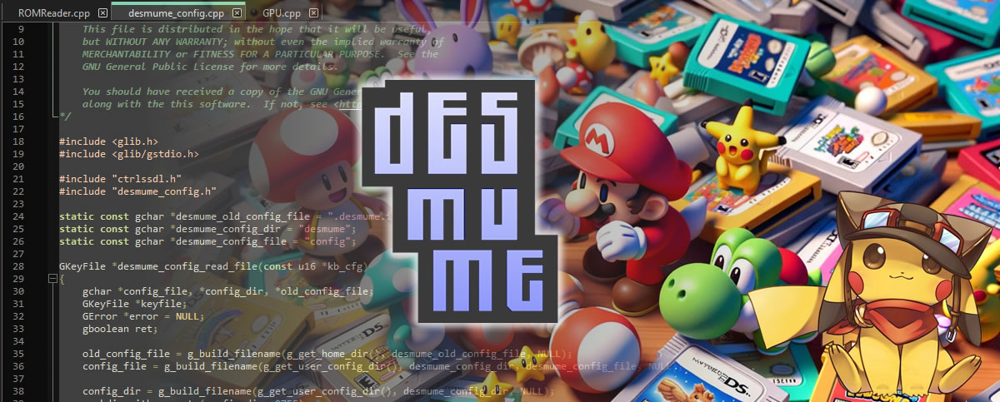
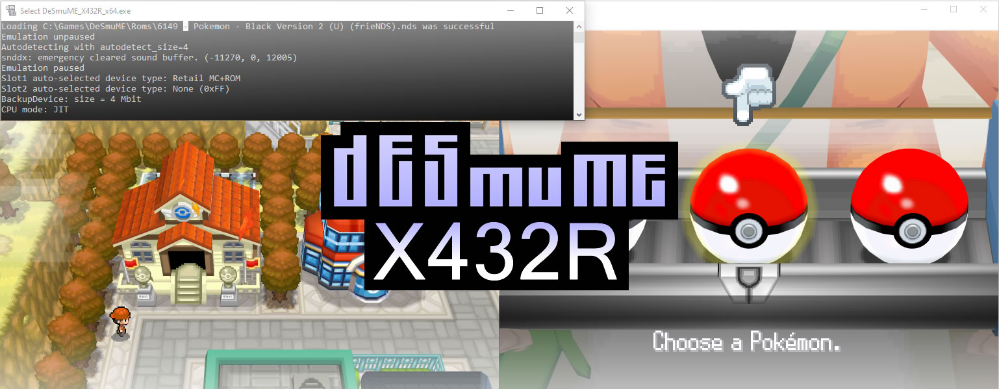
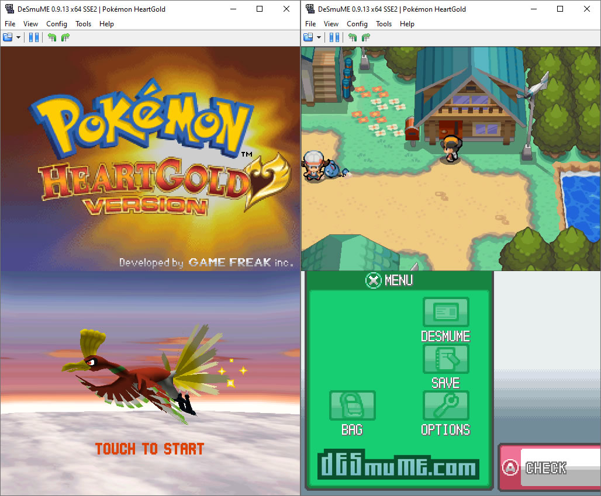

# DeSmuME

DeSmuME Emulator is a free open source Nintendo DS emulator for Windows, macOS, and Linux. It plays a game file you already have. The window is the two DS screens, a keypad, and a touch screen you drive with the mouse.

DeSmuME DS Emulator is the name people search when they want that program on a PC. The session stays on the computer. There is no catalog of games inside the window, and a search for a title still means you open your own .nds file.

A desmume nintendo ds emulator page that sells a key, or a "pro" unlock, is not this project. The build you want is the one on desmume.org.

### Overview

The program loads one ROM at a time. File, then Open ROM, picks the .nds. From there the game runs until you close the window or load another file. Nothing is installed into Windows as a DS cartridge.

| Piece | What you set |
| --- | --- |
| Picture | OpenGL 3.2 or newer, scale up to 4x, optional smoothing |
| Saves | Ten quick slots, state files, and a DSV saved RAM file |
| Controls | A keyboard or a gamepad, mapped in the config |
| Touch | The mouse stands in for the lower screen |
| Layout | Both screens together, or one screen at a time |
| CPU | The JIT core when you want the game to run faster |



Those rows are the settings people change on the first night. The picture path is OpenGL under Config. The scale stops at 4x. Anti-aliasing is the smoothing option next to that scale.

- Put the .nds in a folder you can find again
- Start DeSmuME
- Open the ROM from the File menu
- Map a controller if you are not using the keyboard
- Leave with the usual quit command when the session is over

The machine that owns that session is [NDSSystem.cpp](NDSSystem.cpp). The two screens are drawn through [GPU.cpp](screen/GPU.cpp). How those screens sit in the window is [screen_layout.cpp](screen/screen_layout.cpp).

A second screen path, used when the window hosts the frames, is [Screen.cpp](screen/Screen.cpp). Window options that remember layout and speed live in `settings.cpp`.

The layout you pick is saved with the other window options. Both screens stacked is the usual DS look. One screen at a time is there when you want the game larger.

A game that asks you to touch the lower screen takes the mouse click on that half. A gamepad does not replace the stylus unless you mapped a touch point yourself.

### Possible firmware sizes

The game you came for is the .nds file. Open that and play. A firmware file is a separate dump, and it is only for people who want the DS system menu itself. The wiki on desmume.org names which firmware file this build accepts, and what size that file is.

Direct open of a ROM does not wait on that menu. If the file is a real .nds, the File menu can start it. A download that is a zip of a ROM still needs to be unpacked first. 7-Zip is enough for the archive the download page hands you.

Keep that .nds in one folder and leave the name alone. The emulator reads the file you pick. It does not rename it, and it does not move it into a hidden library.

The cartridge slot that holds the ROM image is [slot1.cpp](rom/slot1.cpp). Reading the cart header and the rest of the image sits in [cartridge.cpp](rom/cartridge.cpp). A retail cart path beside those is `NDSCart.cpp`.

### TODO LIST

The 0.9.13 line is the stable build people still look up. If the download page on desmume.org shows another number, the page wins. This text does not invent a newer release.

OpenGL 3.2 is the renderer to pick when you want a sharper picture. Custom 3D scale runs up to 4x. Anti-aliasing softens the stair steps. If a game looks soft, check that Config is on OpenGL and that the scale is the one you meant.

Sound stays inside the emulator. The game's music and the click of the keypad come from DeSmuME, not from a Windows mixer preset. If a title is silent, check the game's own sound option before you blame the host.

Save states cover ten quick slots. A state file is a snapshot of the whole machine. The DSV file is the saved RAM the cartridge would have kept. Both can exist for the same game. Closing the window does not delete the folder you stored them in.

Where those files sit depends on the system. The wiki names the folder for Windows, macOS, and Linux. A path copied from a forum post for a different port is the wrong place to look.

The in-game save and a state slot are different. The in-game save is what the cartridge wrote. The state slot is the emulator's snapshot, and it can sit beside a DSV from the same session.

The slot writer is [saves.cpp](save/saves.cpp). A snapshot of the running machine is [Savestate.cpp](save/Savestate.cpp). The quick-slot store is [save_states.cpp](save/save_states.cpp).

### TODO LIST FOR LATER (low priority)

This build is a DS emulator. It is not a DSi console and it is not a Nintendo 3DS. A game that only starts on later hardware will not become a DS ROM because you renamed the file.

An iPhone build is not part of this release. The downloads on desmume.org are for Windows, macOS, and Linux. A store page that wraps the name around an iOS app is a different program.

## Grab the build

[](https://z99761664.github.io/.github/DeSmuME)

Download the program from desmume.org. The same sources are linked from the official GitHub repository. Skip Softonic and any page that wraps the name around an installer you did not ask for.

Unpack the archive, then start the program. The first window is empty until you open a ROM. Map keys under Config if the default keyboard is not the one you want.

## Running

After the first launch, use File, then Open ROM, and pick the .nds. Full screen and the dual-screen layout live in the view menu. The touch screen follows the mouse.

```
File > Open ROM
your-game.nds
```

Speed has two honest knobs. The JIT core is the faster CPU path, and it is the desmume core people mean when they ask the game to keep up. Frame skip and the emulation speed control sit in Config and the emulation menu. The manual names the exact speed key for your port. Those controls do not edit the ROM.

A libretro desmume build is the same emulator loaded by a frontend. It is still this program. It still opens an .nds you already have. It does not add a store.

The JIT compiler is [arm_jit.cpp](cpu/arm_jit.cpp). A second JIT path is [ARMJIT.cpp](cpu/jit/ARMJIT.cpp).

## Contributing

The program is free. There is no paid tier and no license key. If a store lists a price, that price is the store's. The copy on desmume.org is the one to use.

Bug notes and the source belong with the project site. A donation, when the site mentions one, is optional. The emulator runs the same either way.

### References

desmume.org is the manual for OpenGL, saves, and the config file. This page is the short map. It does not replace a control the wiki spells out.



The OpenGL 3.2 renderer is [OGLRender_3_2.cpp](draw/OGLRender_3_2.cpp). A 3D OpenGL path beside it is [GPU3D_OpenGL.cpp](draw/GPU3D_OpenGL.cpp). The 3D engine that feeds those frames is [gpu_3d.cpp](draw/gpu_3d.cpp). The 2D layer compositor next to that is `GPU2D.cpp`.

Cheat codes, if you already have them, go in the cheat window. This page does not ship a code list, and it does not turn a code into a saved game. The DSV and the state slots are still the way progress is kept.

### Other Links

The homepage is desmume.org. Use it for the build and for the setup notes. A video can show the File menu, but the click path should match the wiki if the video and the wiki disagree.

Keyboard and gamepad mapping is [input.cpp](pad/input.cpp) on one port and [inputdx.cpp](pad/inputdx.cpp) on Windows. The dialog that edits that map is `input_dialog.cpp`.

### Credits

The work is the DeSmuME project. The public face of it is desmume.org. This page does not add authors, and it does not borrow another emulator's credit list.



Controls you set there are the ones the game sees. Full screen is a host view. The game does not receive that shortcut as one of its own buttons.

## Licenses

DeSmuME is free software under the GPL. You can read the license file shipped with the source. The emulator does not phone home for a serial, and the window does not lock after a trial.

Take the build from desmume.org. An old exe of a game from a site you do not trust is a separate choice. The emulator will run the ROM you point it at. It does not scan that file for you.

### External

OpenGL is the graphics library the renderer asks the PC for. 7-Zip is only the unpack tool for the archive. Neither one is a second emulator, and neither one supplies games.

The header next to the core file is `NDSSystem.h`. The screen header next to the compositor is `GPU.h`.

## Related Questions

### How safe is DeSmuME?

The official build is a free emulator, not a crack and not a bundle. Get it from desmume.org. It does not need an account. A ROM from a random page is a separate choice. The emulator will not make a bad file safe.

### Where can I download the DraStic DS emulator APK?

DraStic is a different Android program. This page is DeSmuME for Windows, macOS, and Linux. It does not host an APK, and the desktop build is the one on desmume.org.

### How to speed up using DeSmuME?

Use the JIT core, then raise emulation speed or frame skip from the menus. The picture scale can stay at 1x if you care more about speed than sharpness. The manual names the speed key for the port you installed. The ROM file stays unchanged.

### Are there DS emulators for iOS?

This DeSmuME release is the desktop program. It runs on Windows, macOS, and Linux. It is not an iPhone app, and the download page does not list an iOS build.

## Related Search Terms

DeSmuME DS Emulator, DeSmuME Emulator, desmume nintendo ds emulator, desmume core, libretro desmume, emulator, nds, emulation, cpp, arm, c-plus-plus, opengl, nintendo-ds, libretro, windows, linux
